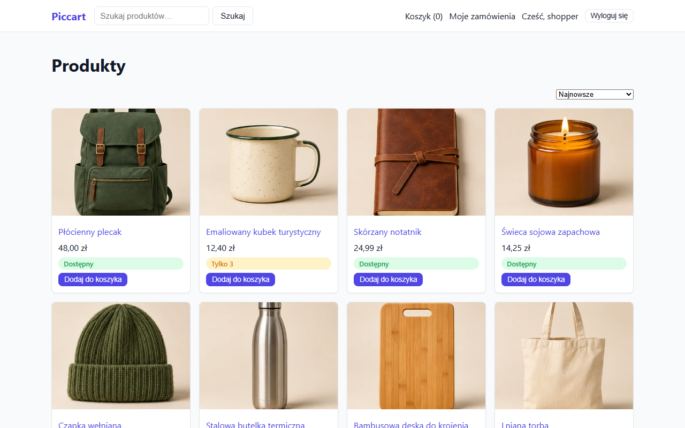

# Piccart — przewodnik po sklepie

Przećwicz zakupy na przykładzie kubka i czapki. Możesz porównać produkty, złożyć próbne zamówienie i wrócić później do jego szczegółów.

*Katalog przykładowych produktów po zalogowaniu.*

## Orientacja w sklepie

- Kliknięcie nazwy Piccart przenosi do katalogu. Numer przy koszyku oznacza łączną liczbę sztuk.

1. Zacznij od pola wyszukiwania w nagłówku.
2. Po zalogowaniu wybierz **Moje zamówienia**, aby sprawdzić wcześniejsze zakupy.
