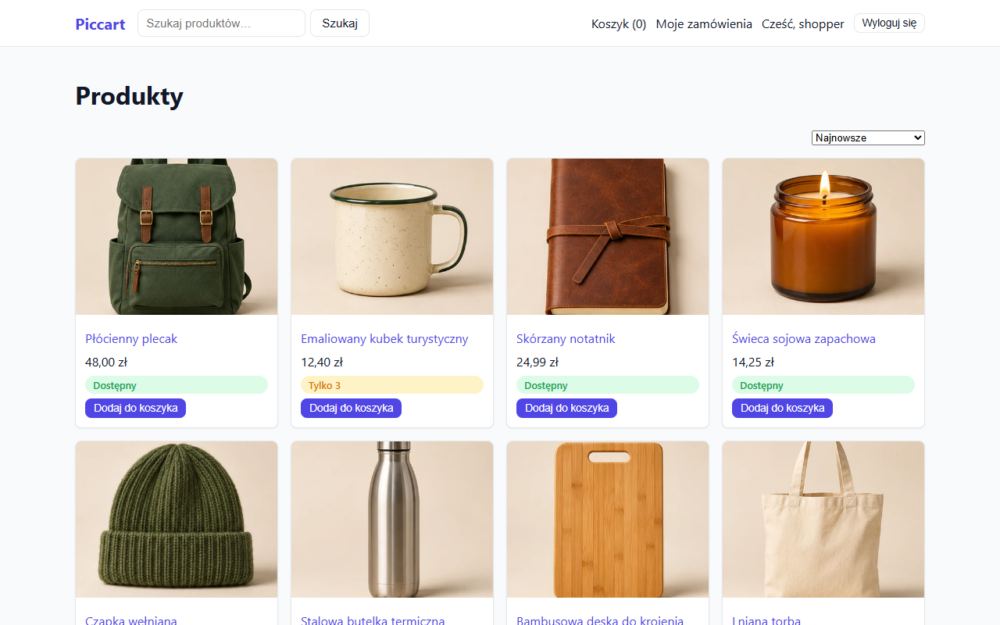

# Pierwsze uruchomienie

Otwórz terminal w folderze Piccart. Przy pierwszym uruchomieniu przygotuj dane demonstracyjne, żeby zobaczyć dziewięć produktów.

*Katalog po wczytaniu produktów demonstracyjnych.*

## Uruchomienie lokalne

- W konsoli przy pierwszym starcie pojawia się ramka z adresem administratora i hasłem. Zapisz je, ponieważ przy kolejnym starcie konta ramka już się nie pojawi.

1. Zainstaluj zależności poleceniem `npm ci --legacy-peer-deps`. Na Windows, jeśli instalacja próbuje kompilować better-sqlite3 i zgłasza MSB8036, użyj `npm ci --legacy-peer-deps --ignore-scripts`. Projekt zawiera gotowy moduł dla Windows x64.
2. Uruchom `npm run seed`, następnie `npm run dev` i otwórz `http://localhost:3000`. Konto klienta demo to `shopper@piccart.test`, hasło `Shopper-Docs-1`.
