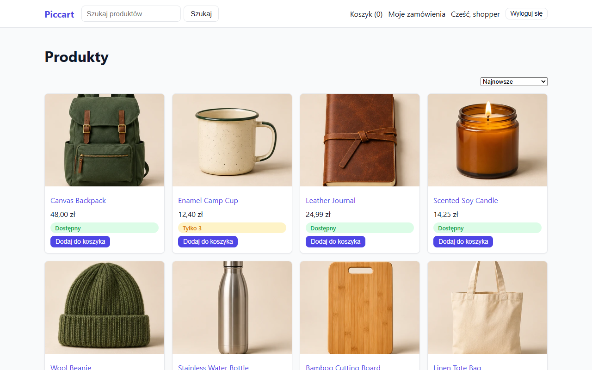
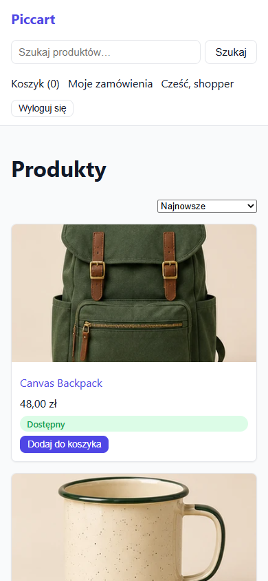

# Przeglądanie produktów

Każda karta pokazuje nazwę, cenę w złotych i aktualną dostępność. Na telefonie karty układają się jedna pod drugą.

*Widok katalogu na komputerze.*

*Katalog w widoku telefonu.*

## Wyszukiwanie i sortowanie

- Zielona etykieta oznacza dostępny produkt, bursztynowa podaje liczbę ostatnich sztuk, a czerwona sygnalizuje brak zapasu.

1. Wpisz `beanie` i naciśnij **Szukaj**. Aby ponownie zobaczyć wszystkie produkty, wyczyść pole i ponów wyszukiwanie.
2. Wybierz sortowanie według ceny lub nazwy. Przy ponad 12 wynikach użyj przycisku **Następna** pod kartami. Gdy wyszukiwanie nic nie zwróci, spróbuj krótszego fragmentu nazwy.
