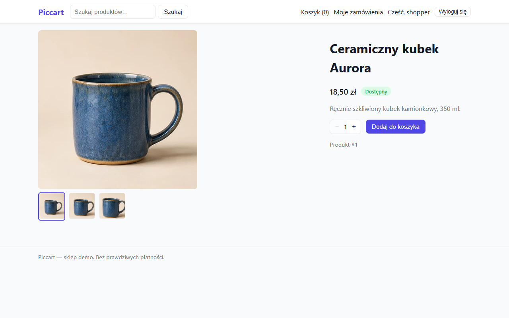
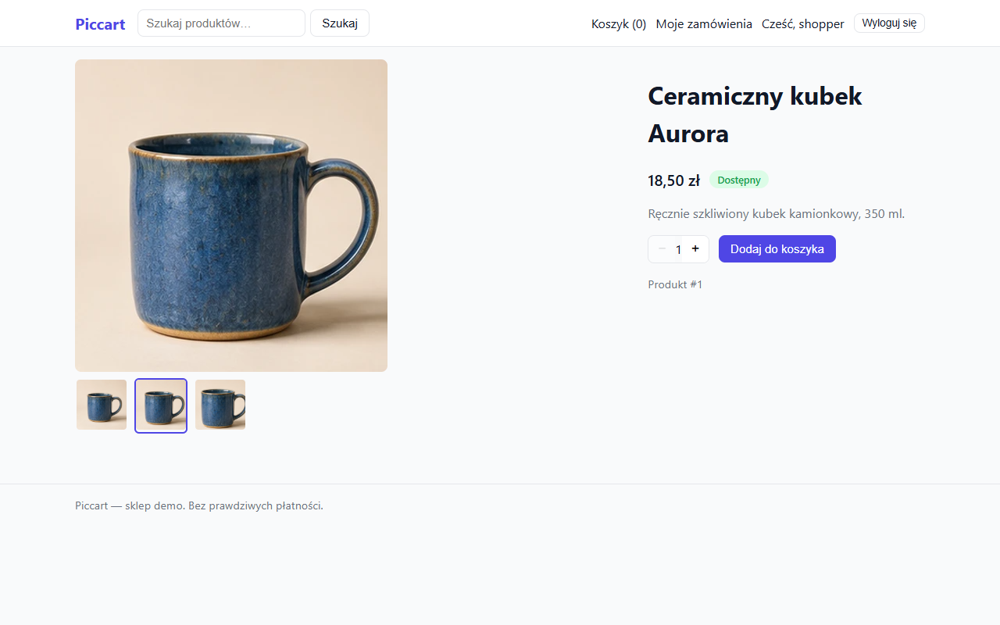

# Szczegóły produktu

Otwórz nazwę produktu, aby zobaczyć opis, trzy zdjęcia, cenę i liczbę sztuk do dodania.

*Pierwsze zdjęcie kubka.*

*Galeria po wybraniu drugiej miniatury.*

## Zdjęcia i liczba sztuk

- Pod dużym zdjęciem znajdziesz trzy miniatury. Obok ceny widnieje stan magazynowy.

1. Kliknij miniaturę, by zmienić główne zdjęcie.
2. Ustaw ilość przyciskami plus i minus. Kliknij **Dodaj do koszyka**. Przy zerowym stanie przycisk jest wyłączony.
