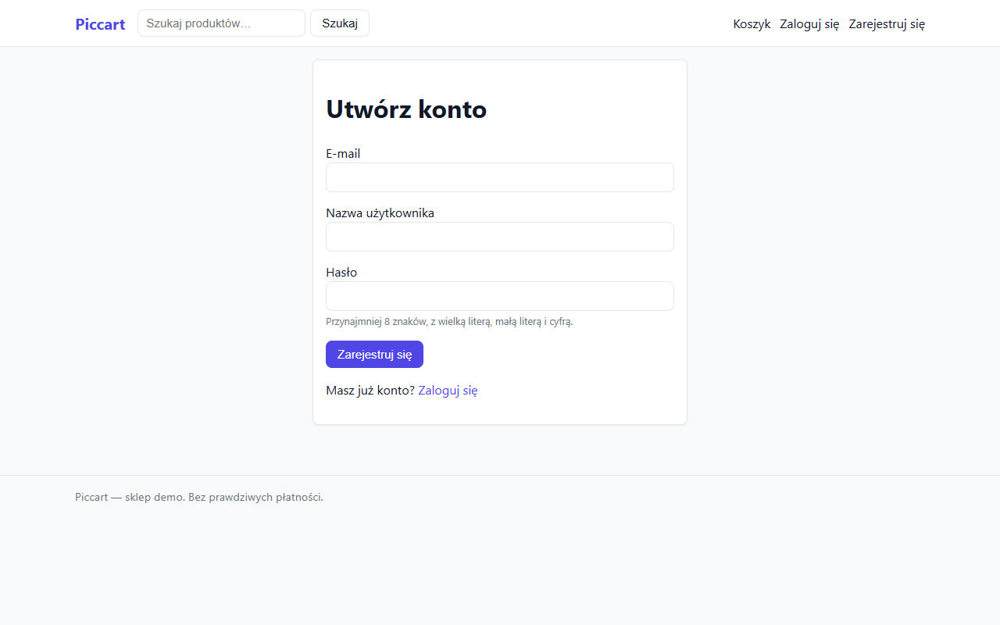
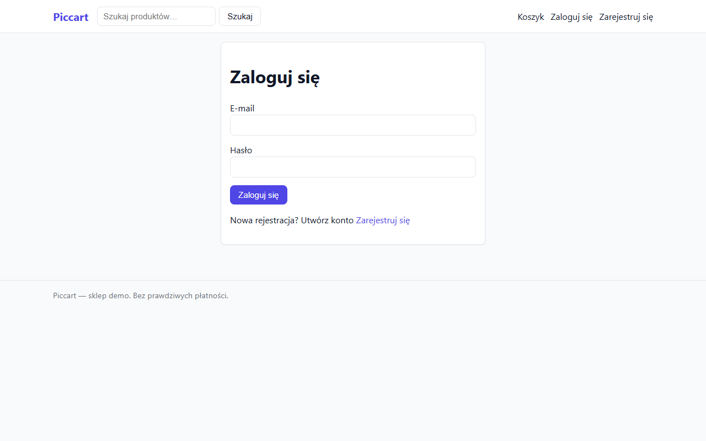

# Konto i logowanie

Załóż konto, by zachować koszyk i sprawdzać swoje zamówienia.

*Formularz tworzenia konta.*

*Formularz logowania.*

## Dostęp do konta

- Rejestracja wymaga adresu e-mail i nazwy użytkownika długości 3–32 znaków. Nazwa może zawierać litery, cyfry, myślnik i podkreślenie.

1. Podaj hasło długości 8–72 znaków z małą literą, wielką literą i cyfrą. Po rejestracji zobaczysz swoją nazwę w nagłówku.
2. Aby wrócić na konto, wybierz **Zaloguj się**. Po błędzie sprawdź e-mail i hasło. Jeśli logowanie rozpoczęło się podczas zakupów, wrócisz do poprzedniego ekranu. Sesję kończy **Wyloguj się**.
