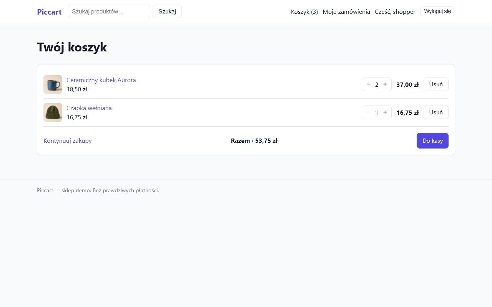

# Twój koszyk

Otwórz **Koszyk** w nagłówku. Przy każdej pozycji możesz sprawdzić cenę za sztukę, ilość i wartość całej pozycji.

*Koszyk z dwoma kubkami i jedną czapką.*

## Zmiana zawartości

- Dwa kubki po 18,50 zł i czapka za 16,75 zł dają łącznie 53,75 zł. Licznik w nagłówku pokazuje trzy sztuki.

1. Zmień ilość przyciskami plus i minus. Jedna pozycja może obejmować maksymalnie 10 sztuk. Jeśli sklep zgłosi mniejszą dostępność, zmniejsz ilość.
2. Wybierz **Usuń**, aby skasować pozycję. Po usunięciu ostatniej pozycji możesz wrócić do katalogu. Z pełnego koszyka wybierz **Do kasy**.
