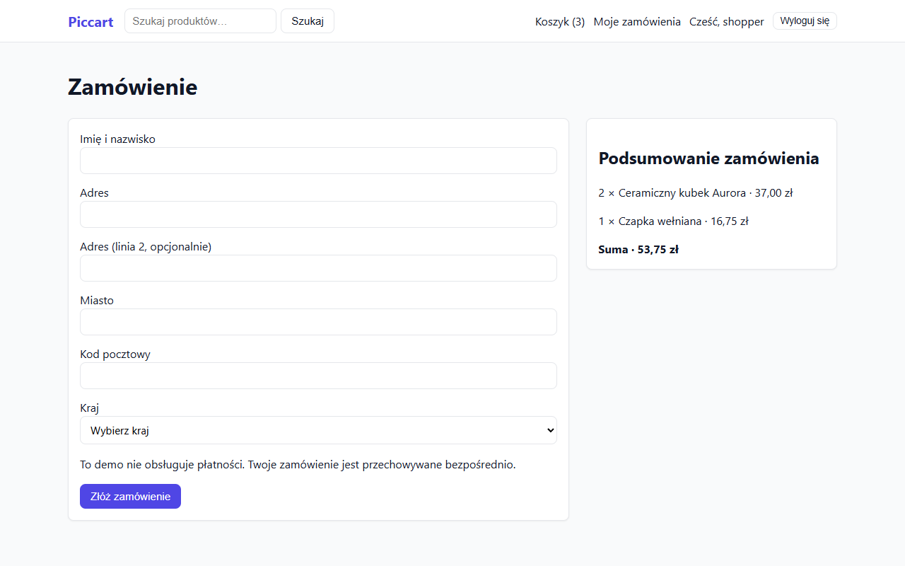
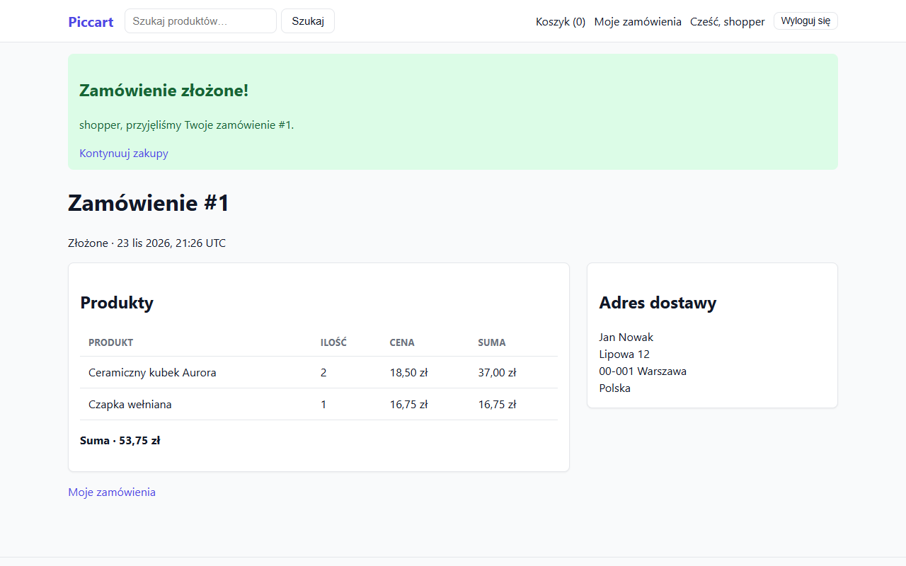

# Składanie zamówienia

Sprawdź produkty i sumę w podsumowaniu obok formularza dostawy. Sklep demonstracyjny nie pobiera opłaty.

*Dane dostawy i suma zamówienia.*

*Potwierdzenie z numerem zamówienia.*

## Dane dostawy

- Formularz wymaga imienia i nazwiska, adresu, miasta, kodu pocztowego i kraju. Druga linia adresu jest opcjonalna.

1. Wypełnij pola i wybierz **Złóż zamówienie**. Komunikat pod polem podpowie, co poprawić. Jeśli zapas się zmienił, wróć do koszyka i dostosuj ilość do dostępnej.
2. Po potwierdzeniu zapisz numer widoczny na ekranie. Zakupione sztuki znikną z koszyka, a szczegóły znajdziesz w historii.
