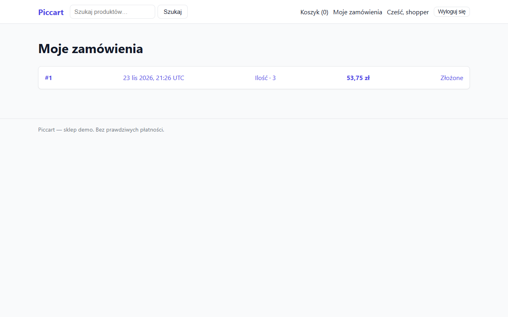
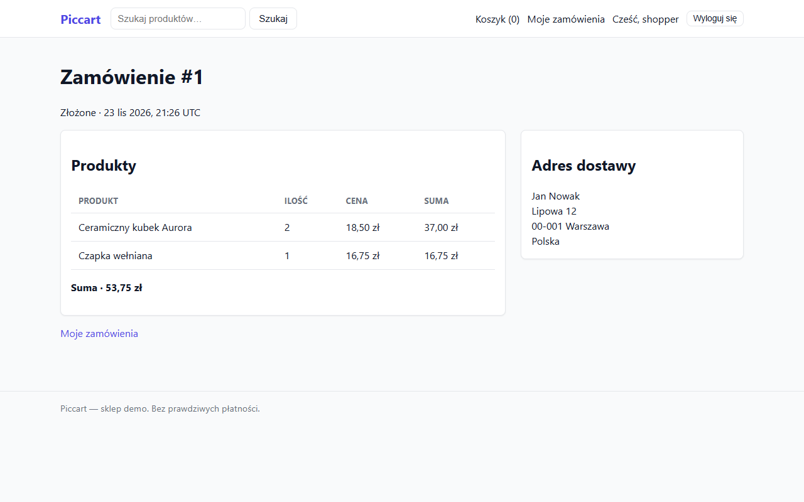

# Historia zamówień

Wybierz **Moje zamówienia**. Najnowszy zakup pojawia się na początku listy.

*Historia zakupów klienta.*

*Adres dostawy i zakupione pozycje.*

## Odczytywanie zamówienia

- Lista pokazuje numer, datę w UTC, liczbę sztuk, sumę i status. Każde konto widzi własną historię.

1. Otwórz wiersz z odpowiednim numerem. Sprawdź adres dostawy i ilości przy poszczególnych produktach.
2. Porównaj ceny jednostkowe z sumą. Nazwy i kwoty odzwierciedlają moment zakupu, również po późniejszej zmianie oferty.
