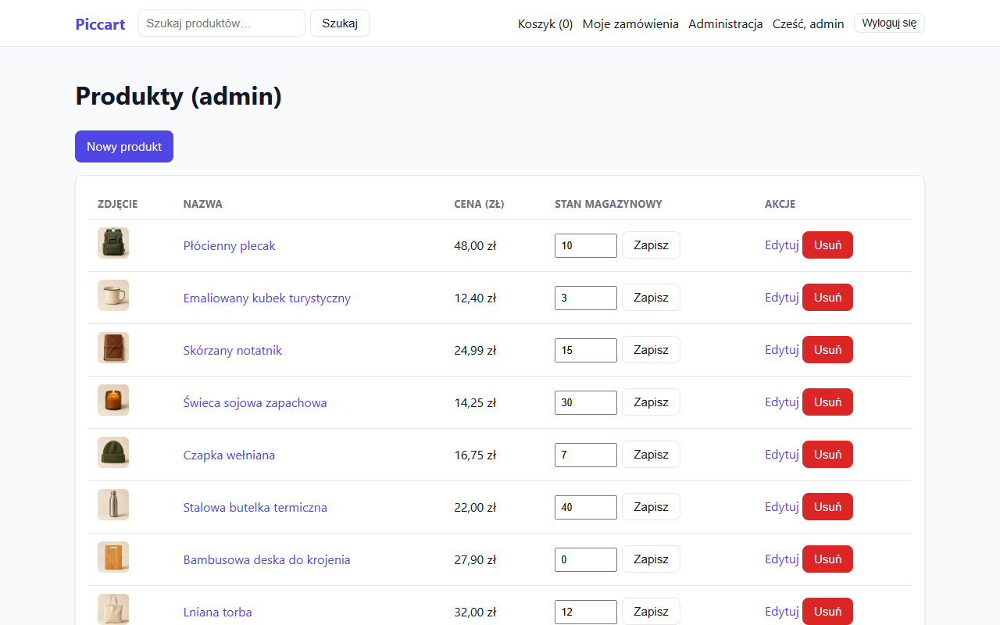
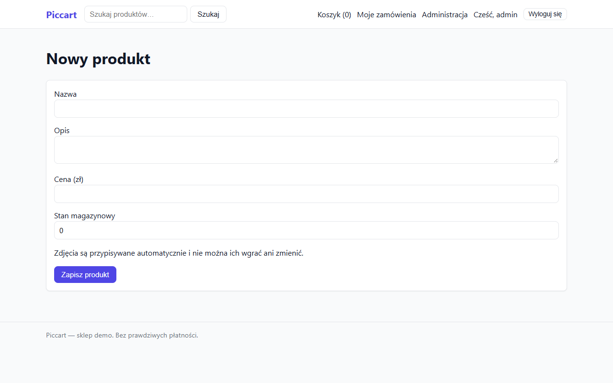
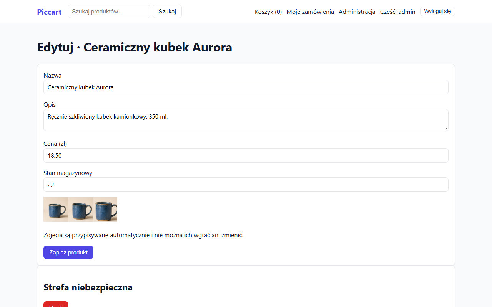

# Administracja produktami

Zaloguj się na konto administratora i wybierz **Administracja** w nagłówku.

*Lista produktów ze stanami magazynowymi.*

*Dodawanie nowego produktu.*

*Edycja ceny, opisu i stanu.*

## Obsługa oferty

- Tabela zestawia zdjęcie, nazwę, cenę i stan magazynowy każdego produktu.

1. Aby zmienić zapas, wpisz liczbę sztuk w wierszu i kliknij **Zapisz**. Aby rozszerzyć ofertę, wybierz **Nowy produkt**, wpisz nazwę, opis, cenę i stan. Zdjęcia zostaną przypisane automatycznie.
2. Otwórz **Edytuj**, żeby zmienić cenę lub nazwę. Usunięcie wymaga potwierdzenia. Produkt znika z katalogu i koszyków, a złożone zamówienia zachowują wcześniejsze dane.
